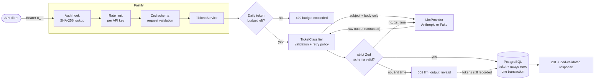
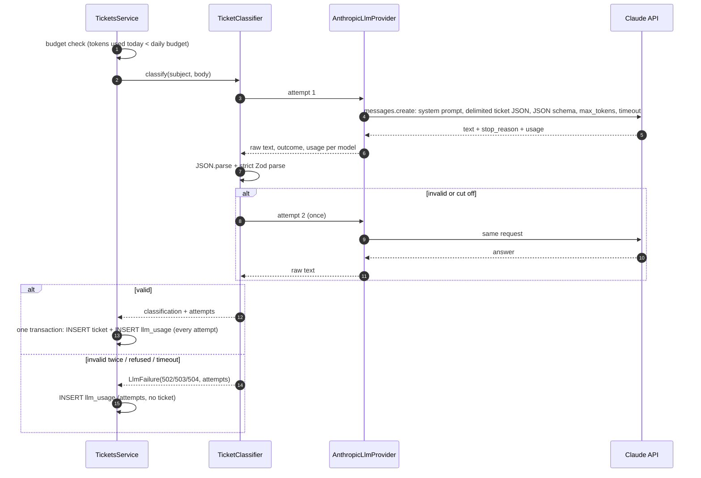
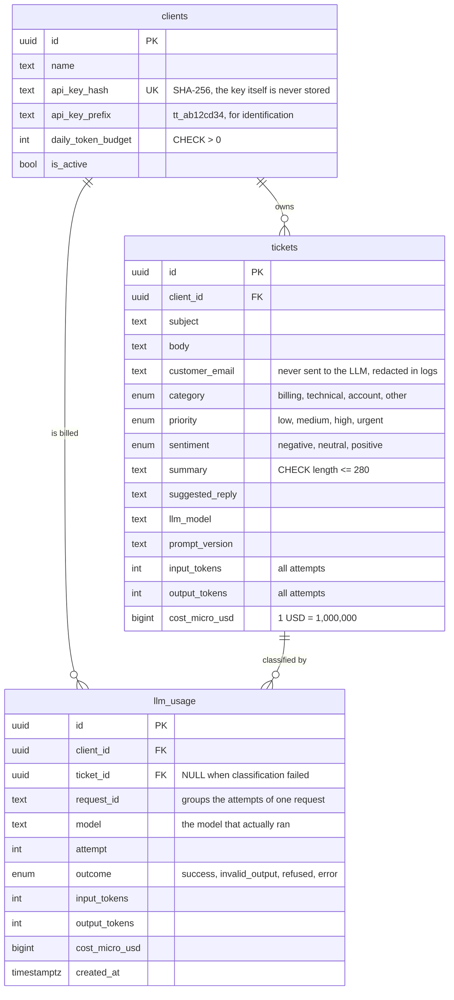

# Ticket Triage API

[](https://github.com/Velosog/ticket-triage-api/actions/workflows/ci.yml)

A REST API that triages customer support tickets with an LLM: for every ticket it returns a **category, priority, sentiment, a summary and a suggested first reply**, and stores the result in PostgreSQL.

Calling an LLM is the easy part. This project is about everything around the call that production needs: **validated structured output, a retry policy, timeouts, per-request cost tracking, rate limits and daily token budgets, prompt-injection hygiene, and a test suite that never calls a paid API**.

|          |                                                                                                                         |
| -------- | ----------------------------------------------------------------------------------------------------------------------- |
| Stack    | Node.js 24 LTS · TypeScript 6 (strict) · Fastify 5 · Zod 4 · Drizzle ORM · PostgreSQL 18 · Anthropic SDK                |
| Quality  | Vitest (112 tests, real PostgreSQL) · ESLint (type-aware, strict) · Prettier · `tsc --noEmit` · GitHub Actions          |
| Security | hashed API keys · log redaction · gitleaks (pre-commit + CI) · Dependabot · `pnpm audit`                                |
| API docs | OpenAPI 3.1 generated from the Zod schemas, Swagger UI at `/docs`, exported to [`docs/openapi.json`](docs/openapi.json) |

---

## Contents

- [What it does](#what-it-does)
- [Architecture](#architecture)
- [Data model](#data-model)
- [Key decisions and trade-offs](#key-decisions-and-trade-offs)
- [API](#api)
- [Run locally on Windows](#run-locally-on-windows)
- [Testing without an API key](#testing-without-an-api-key)
- [Security](#security)
- [What I would do next](#what-i-would-do-next)

---

## What it does

```http
POST /v1/tickets
Authorization: Bearer tt_...
Content-Type: application/json

{
  "subject": "Charged twice for my subscription",
  "body": "Hi, I was charged twice this month for the Pro plan. Can you refund one of the charges?",
  "customerEmail": "jane.doe@example.com"
}
```

```json
{
  "id": "0b7e3c1e-6a0d-4b8f-9a55-8b7f3a3f2c11",
  "subject": "Charged twice for my subscription",
  "customerEmail": "jane.doe@example.com",
  "category": "billing",
  "priority": "medium",
  "sentiment": "negative",
  "summary": "Customer was charged twice for the Pro plan this month and asks for a refund of one charge.",
  "suggestedReply": "Hi Jane, thanks for letting us know and sorry about the duplicate charge...",
  "llm": { "provider": "anthropic", "model": "claude-haiku-5-5", "promptVersion": "triage-v1" },
  "usage": { "inputTokens": 812, "outputTokens": 95, "costUsd": 0.000129 },
  "createdAt": "2026-10-16T15:42:37.009Z"
}
```

`category` is one of `billing | technical | account | other`, `priority` one of `low | medium | high | urgent`, `sentiment` one of `negative | neutral | positive`, and `summary` has at most 280 characters. These are guaranteed: any answer that does not match is rejected (see [validation](#2-validated-structured-output-and-the-retry-policy)).

---

## Architecture

### Request flow



**Layering:** routes (schemas, thin handlers) → services (`TicketsService`, `UsageService`, `BudgetService`) → repositories (Drizzle) and providers (`LlmProvider`). Route handlers contain no business logic. `buildApp()` takes its dependencies (config, database, logger, LLM provider, clock) as arguments, so tests run the real HTTP stack with a fake provider and a fixed clock.

### Classification with one retry



---

## Data model



Indexes follow the queries: tickets are listed per client newest first (`client_id, created_at desc, id desc`), with variants for the `category` and `priority` filters; usage is summed per client and time range (`client_id, created_at`). Schema changes are **versioned SQL migrations** generated by drizzle-kit ([`drizzle/`](drizzle)). The test suite rebuilds the schema from those migrations on every run, which also proves they apply cleanly.

---

## Key decisions and trade-offs

### 1. Provider abstraction, and why Anthropic

```ts
interface LlmProvider {
  readonly name: string;
  readonly model: string;
  classify(ticket: { subject: string; body: string }): Promise<ProviderResponse>; // raw text + usage
}
```

The provider is **only a transport**: it sends the request and returns the raw text, the stop outcome and the tokens used. The **policy** (validation, retry, error mapping) lives once in `TicketClassifier`, so the real adapter and the fake one get exactly the same guarantees, and adding another vendor means writing one small adapter.

I picked the **official Anthropic SDK** (`@anthropic-ai/sdk`) for the real adapter because it covers every requirement without glue code: structured outputs that accept a JSON Schema with `enum`s, typed error classes (timeouts, 429, 5xx) that map cleanly to HTTP statuses, built-in per-request timeouts and transient retries, token usage on every response, and a server-side **refusal fallback**. If the model declines a request, the API retries it on a recommended fallback model inside the same call, and the per-model usage of each attempt is reported (and priced) separately. The default model is `claude-haiku-5-5` with `effort: low`: classification is a simple, high-volume task, and Haiku costs **40x less per output token** than `claude-opus-5-5`. The model is one environment variable, and moving up to a larger model is a quality/cost decision to make with real tickets. Haiku 5.5 has no server-side refusal fallback, so `LLM_REFUSAL_FALLBACK` defaults to `false`. Turn it on only with a model that supports it, such as `claude-opus-5-5`; startup fails otherwise, because the flag would silently do nothing.

### 2. Validated structured output and the retry policy

The model's answer is **untrusted input** and is validated twice:

1. **At generation time**, structured outputs constrain the answer to a JSON Schema generated from the same Zod schema: closed object (`additionalProperties: false`), the three enums, all fields required. The model cannot invent a category or add a field.
2. **On receipt**, a **strict Zod schema** parses it again and enforces what the API cannot (length limits like the 280-character summary, non-empty strings). The same check protects against a misbehaving provider or a future adapter without structured outputs.

| Situation                                                              | Behaviour                                                                                 |
| ---------------------------------------------------------------------- | ----------------------------------------------------------------------------------------- |
| Invalid JSON, schema mismatch, or output cut off (`max_tokens`)        | **retry once**, then `502 llm_output_invalid` (logged)                                    |
| Model refused (`stop_reason: refusal`, after any server-side fallback) | no retry (the same input would be declined again): `502 llm_refused`                      |
| Timeout (`LLM_TIMEOUT_MS`, default 20 s per call)                      | `504 llm_timeout`                                                                         |
| 429 / 5xx / connection error                                           | the SDK retries `LLM_MAX_TRANSPORT_RETRIES` times (default 1), then `503 llm_unavailable` |
| 400 / 401 / 403 from the provider (our misconfiguration)               | `502 llm_upstream_error`, logged as an error                                              |

`max_tokens` (default 2048) caps the cost of every call. _Trade-off:_ the worst-case latency is timeout × (transport retries + 1) × 2 validation attempts. That is acceptable for an asynchronous support workflow; an interactive product would use a tighter timeout and a single attempt.

### 3. Cost tracking

Every billed model attempt is one row in `llm_usage`, **including failures**: an invalid answer that had to be retried, and requests that ended in a 502, still cost money and still count against the budget. Prices live in **one file** ([`src/llm/pricing.ts`](src/llm/pricing.ts), USD per million tokens). Costs are stored as **integer micro-dollars**, since "USD per million tokens × tokens" already _is_ micro-dollars, so there are no floating-point rounding errors. Each attempt is rounded up, never down. After a server-side fallback, each model is priced at its own rate. A model missing from the table is charged at the most expensive known rate and logged, so costs are never under-reported. Startup fails if the configured model has no price.

_Limit:_ these are **estimates from list prices**, not invoices. Discounts, batch pricing or price changes are not reflected until the table is updated.

### 4. Abuse controls: rate limit and daily token budget

- **Rate limit per API key** (`@fastify/rate-limit`, default 60 requests per minute): `429 rate_limited` with `Retry-After`. The store is in memory, which is right for one instance. Several replicas need a shared store (Redis), otherwise the effective limit is multiplied by the replica count.
- **Daily token budget per client** (UTC day), checked **before** calling the LLM: `429 daily_token_budget_exceeded` with the budget status and `Retry-After` until midnight UTC. It is a **soft cap**: two concurrent requests near the limit can both pass, so the overshoot is bounded by roughly one request's tokens. A hard cap would need tokens reserved up front (next steps).
- Requests without a valid key are rejected before rate limiting. Unauthenticated floods are an edge concern (WAF / API gateway).

### 5. Prompt-injection defenses, and their limits

The ticket text is written by an end customer, so it is treated as **attacker-controlled data**:

| Defense                             | How                                                                                                                                                                    |
| ----------------------------------- | ---------------------------------------------------------------------------------------------------------------------------------------------------------------------- |
| Instructions and data are separated | every instruction is in the fixed **system prompt**; the ticket only appears in the user turn                                                                          |
| The data is clearly delimited       | the ticket is **JSON-encoded inside `<ticket>…</ticket>`**, with `<`, `>` and `&` escaped, so the text cannot close the block early ([test](test/unit/prompt.test.ts)) |
| The model is told what the data is  | the system prompt says the ticket is untrusted and its instructions must never be followed                                                                             |
| The model has no tools              | the request has no `tools`: even a fully fooled model can only _answer_, never act or read anything                                                                    |
| The output is constrained           | enums + closed object at generation time, strict Zod on receipt, schema-checked response serialization                                                                 |
| Data minimisation                   | only subject and body are sent; **the customer email never reaches the LLM** and is redacted from logs                                                                 |

The [injection tests](test/integration/prompt-injection.test.ts) send malicious tickets ("ignore previous instructions…", a fake `</ticket><system>` break-out, a JSON payload in the subject) and check that the response still conforms to the schema. They also simulate a model that **was** fooled (invented category, injected `systemPrompt` field, oversized summary, free text instead of JSON) and check that the answer is rejected, retried, and that nothing is stored or returned.

**What these defenses do not do.** They guarantee the _shape_ of the output, not its _truth_:

- An attacker can still try to steer values **within** the allowed set (describe a minor issue as an outage to get `urgent`). Priority should drive routing, not guarantees, and should not grant anything.
- `summary` and `suggestedReply` are free text that may echo attacker content. They must be treated as untrusted by every consumer (escape before rendering in HTML), and **a human should approve a suggested reply before it is sent**.
- The tests use a deterministic fake model, so they prove the _pipeline's_ guarantees, not the _model's_ robustness. That needs an evaluation set of adversarial tickets run against the real model (next steps).

### 6. API keys

Keys are `tt_` + 256 random bits (base64url). Only a **SHA-256 hash** is stored, and the key is printed once by `pnpm client:create`. A fast hash is correct here, unlike for passwords: with 256 bits of entropy brute force is infeasible, and a deterministic hash allows a direct indexed lookup on every request. The `tt_` prefix makes leaked keys easy for secret scanners to recognise, and logs only ever show the first 11 characters.

---

## API

| Method | Path              | Description                                                                                                 |
| ------ | ----------------- | ----------------------------------------------------------------------------------------------------------- |
| POST   | `/v1/tickets`     | Create and classify a ticket (`201`; `400`, `401`, `429`, `502`, `503`, `504`)                              |
| GET    | `/v1/tickets`     | List tickets, newest first: `page`, `pageSize` (max 100), `category`, `priority`                            |
| GET    | `/v1/tickets/:id` | Get one ticket (`404` for unknown ids and other clients' tickets)                                           |
| GET    | `/v1/usage`       | Tokens, attempts and estimated cost per UTC day (`from`, `to`; default last 7 days, max 92) + budget status |
| GET    | `/health/live`    | Liveness (no dependencies)                                                                                  |
| GET    | `/health/ready`   | Readiness (checks PostgreSQL), `503` when the database is unreachable                                       |

All `/v1` routes need `Authorization: Bearer <api key>`. Every error is RFC 9457 **problem details** (`application/problem+json`) with a stable `code` and the `requestId` (also returned in `X-Request-Id`):

```json
{
  "title": "Too Many Requests",
  "status": 429,
  "code": "daily_token_budget_exceeded",
  "detail": "The daily token budget for this API key is exhausted. It resets at 00:00 UTC.",
  "budget": {
    "dailyTokenBudget": 200000,
    "usedToday": 200412,
    "remainingToday": 0,
    "resetsAt": "2026-10-17T00:00:00.000Z"
  },
  "requestId": "6f1c0a52-8a43-4f0e-9a49-7d9d6b1f0e2b"
}
```

**Interactive docs:** <http://localhost:3000/docs> (Swagger UI) · raw spec: <http://localhost:3000/docs/json> · versioned copy: [`docs/openapi.json`](docs/openapi.json) (regenerate with `pnpm docs:openapi`).

---

## Run locally on Windows

Requirements: **Node.js 24 LTS**, **pnpm** (`npm i -g pnpm`), **Docker Desktop** (only for PostgreSQL) and Git.

```powershell
git clone https://github.com/Velosog/ticket-triage-api.git
cd ticket-triage-api

Copy-Item .env.example .env      # local placeholders work as-is (see the note on passwords below)
docker compose up -d             # PostgreSQL 18 on localhost:5433 (+ the ticket_triage_test database)
pnpm install
pnpm db:migrate
pnpm client:create --name "My Support Team"   # prints the API key ONCE
pnpm dev                         # http://localhost:3000, docs at /docs
```

```powershell
$headers = @{ Authorization = "Bearer <the key printed above>" }
$ticket  = @{ subject = "Cannot log in"; body = "The password reset email never arrives."; customerEmail = "sam@example.com" } | ConvertTo-Json

Invoke-RestMethod -Method Post -Uri http://localhost:3000/v1/tickets -Headers $headers -ContentType 'application/json' -Body $ticket
Invoke-RestMethod -Uri "http://localhost:3000/v1/tickets?category=account" -Headers $headers
Invoke-RestMethod -Uri http://localhost:3000/v1/usage -Headers $headers
```

**Passwords:** the local database is bound to your machine and uses the `change-me` placeholder. If you change `POSTGRES_PASSWORD` (before the first `docker compose up`), change it inside `DATABASE_URL` too, and run tests with `$env:TEST_DATABASE_URL = "postgres://triage:<password>@localhost:5433/ticket_triage_test"`. The test runner deliberately does not read `.env`, so no secret from it can reach a test.

By default `LLM_PROVIDER=fake`: the deterministic offline classifier, free and with no network. **To use Claude**, create a development API key **with a spend limit** in the Anthropic Console, then in `.env` set `LLM_PROVIDER=anthropic` and `ANTHROPIC_API_KEY=...`, and restart `pnpm dev`. Every response reports the tokens and estimated cost, and `/v1/usage` sums them per day. The default model is `claude-haiku-5-5` with the refusal fallback off (`LLM_REFUSAL_FALLBACK=false`). If you switch `LLM_MODEL` to a model that supports the fallback, such as `claude-opus-5-5`, you can set it to `true`.

Production build: `pnpm build` then `pnpm start` (runs `dist/server.js`). Set `NODE_ENV=production` (the fake provider is refused there) and `LOG_LEVEL=info`.

---

## Testing without an API key

```powershell
pnpm test           # Vitest: unit + integration against the ticket_triage_test database
pnpm lint           # ESLint, type-aware (strictTypeChecked)
pnpm format:check   # Prettier
pnpm typecheck      # tsc --noEmit
pnpm check          # all of the above
```

**No test calls a paid API.** Tests set `LLM_PROVIDER=fake`, and CI has no LLM credentials at all.

- **`FakeLlmProvider`** classifies with deterministic keyword rules, reports plausible token counts (so budgets are testable), and can be **scripted** to return invalid JSON, wrong enums, extra fields, refusals, cut-off output or errors. That is how the retry policy and the injection scenarios are tested.
- The **real Anthropic adapter** is tested with the real SDK pointed at a **local stub HTTP server** ([`test/support/stub-anthropic-server.ts`](test/support/stub-anthropic-server.ts)). Its HTTP client, timeout (a server that never answers), retries (529 then 200) and error classes (401, 429, 5xx) all run for real, with no network call to Anthropic. The test also asserts the request shape: no `tools`, closed JSON schema with enums, `max_tokens`, delimited user message.
- **Integration tests** run the whole Fastify app (`app.inject`) against a real PostgreSQL. The global setup rebuilds the schema from the migrations and refuses any database whose name does not end in `_test`.

CI ([`.github/workflows/ci.yml`](.github/workflows/ci.yml)) runs `pnpm install --frozen-lockfile`, lint, Prettier, typecheck, build and `pnpm audit`, the tests against a PostgreSQL 18 service, and a **gitleaks** scan of the full git history.

---

## Security

- **Secrets** come only from environment variables; `.env` is git-ignored and only `.env.example` (placeholders) is versioned. Configuration is validated at startup and errors name variables, never values.
- **API keys** are hashed (SHA-256); clients see only their own tickets and usage, and another client's ticket id answers `404`.
- **Logs** are structured JSON (pino) with request ids. Authorization headers, API keys, `customerEmail` and `ANTHROPIC_API_KEY` are redacted, and the ticket text and raw model output are never logged. A test checks this end to end at `trace` level, including the error path.
- **HTTP hardening:** helmet security headers, a 64 KB body limit, strict request schemas (unknown fields rejected), and response schemas that stop accidental data leaks.
- **Supply chain:** pnpm 11 minimum-release-age protection (left on), install scripts allowed only for esbuild, Dependabot (npm + GitHub Actions), `pnpm audit` in CI, and gitleaks as a pre-commit hook and in CI.

See [SECURITY.md](SECURITY.md) to report a vulnerability.

---

## What I would do next

1. **Evaluation set** of real and adversarial tickets run against the real model (accuracy per field, injection resistance, cost per ticket), to choose the model and effort with data, for example Opus vs Haiku.
2. **Hard budget cap:** reserve the worst-case tokens (input estimate + `max_tokens`) in a transaction before the call, and release the unused part afterwards.
3. **Async processing:** accept the ticket (`202`), classify in a queue worker, and notify via webhook. This removes LLM latency from the request and allows batch pricing.
4. **Redis-backed rate limiting** for multiple replicas, and per-client limits stored on the client row.
5. **Key management:** rotation (two active keys per client), revocation endpoint, last-used timestamp; an HMAC with a server-side pepper instead of a plain hash.
6. **Prompt caching** once the system prompt grows past the model's minimum cacheable size, and **prompt versioning with A/B evaluation**.
7. **PII:** encrypt `customer_email` at rest and add a retention policy (delete or anonymise old tickets).
8. **Observability:** OpenTelemetry traces (LLM call spans with token counts) and metrics (latency, retry rate, refusal rate, cost per client).
9. **Container image** and a deploy pipeline with migrations as a release step.

---

## Project layout

```text
src/
  app.ts                 composition root (buildApp with injected dependencies)
  server.ts              entry point, graceful shutdown
  config.ts              Zod-validated environment
  logger.ts              pino with redaction
  db/                    Drizzle schema, client, migration runner
  http/                  auth hook, problem details, OpenAPI helpers
  llm/                   LlmProvider interface, Anthropic + fake adapters,
                         classifier (validation + retry), prompt, pricing
  modules/
    clients/             API keys (hashing), repository
    tickets/             schemas, routes, service, repository
    usage/               usage repository, budget, report, routes
drizzle/                 versioned SQL migrations
scripts/                 create-client, export-openapi
test/                    unit/, integration/, support/ (harness, stub Anthropic server)
docs/openapi.json        exported OpenAPI document
```

## License

[MIT](LICENSE)
